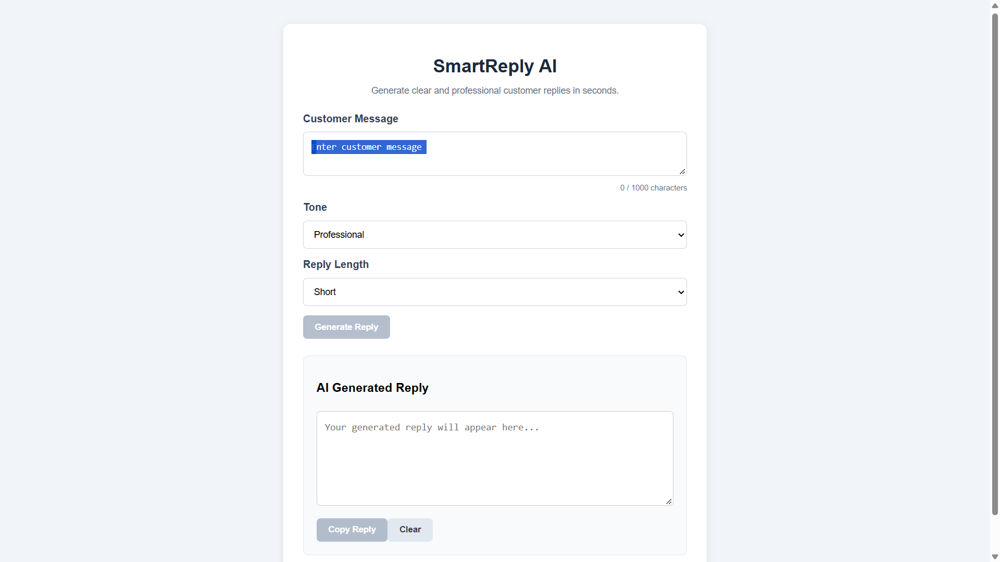
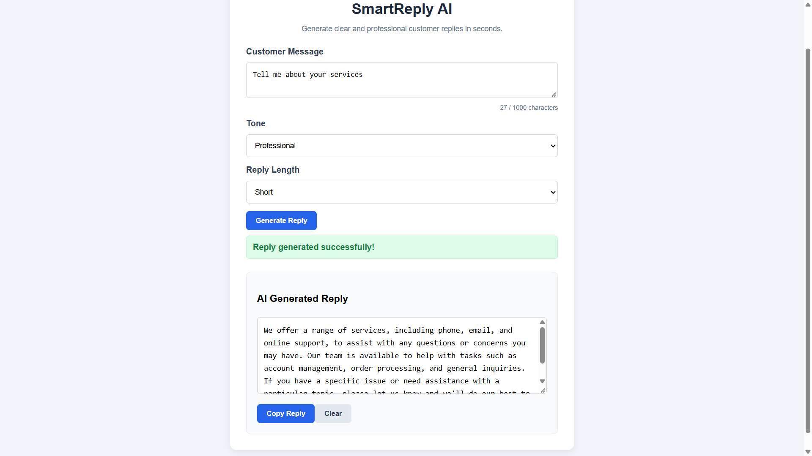
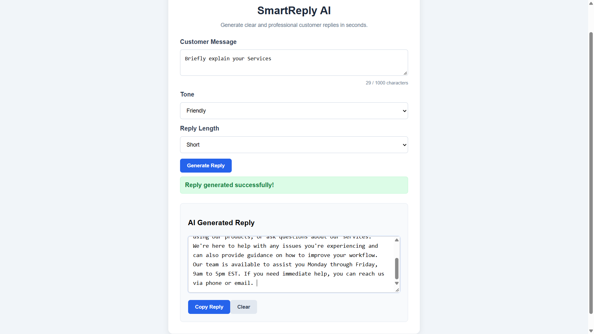

# SmartReply AI

An AI-powered customer enquiry reply assistant that helps businesses generate clear and professional responses to customer messages.

## Features

- Generate customer replies using AI.
- Choose reply tone: Professional, Friendly, or Polite.
- Choose reply length: Short, Medium, or Detailed.
- Edit generated replies before copying.
- Copy replies to the clipboard.
- Input validation and character limit.
- Loading indicator and error handling.
- API rate limiting.

## Technology Stack

**Frontend**
- Angular
- TypeScript
- HTML
- CSS

**Backend**
- ASP.NET Core Web API (.NET 8)
- C#
- HttpClient

**AI**
- Ollama
- Llama 3.2 (1B)

## Project Structure

```text
SmartReplyAI/
├── Backend/
│   ├── AISmartReply/
│   │   ├── Controllers/
│   │   ├── Models/
│   │   ├── Services/
│   │   └── Program.cs
│   └── AISmartReply.sln
│
├── Frontend/
│   └── AISmartReplyUI/
│       ├── src/
│       ├── public/
│       └── package.json
│
└── README.md
```

## Prerequisites

- .NET 8 SDK
- Node.js and npm
- Angular CLI
- Ollama

## Getting Started

### 1. Set up Ollama

Install Ollama and download the model:

```bash
ollama pull llama3.2:1b
```

Make sure Ollama is running locally.

### 2. Run the Backend

Open the solution in Visual Studio.

1. Open `Backend/AISmartReply.sln`.
2. Set AISmartReply as the startup project.
3. Run the application.
4. Open Swagger to test the API.

### 3. Run the Frontend

Open a terminal in:

`Frontend/AISmartReplyUI`

Install dependencies:

```bash
npm install
```

Start Angular:

```bash
ng serve
```

Open:

`http://localhost:4200`

## How It Works

1. Enter a customer enquiry.
2. Select the preferred tone and reply length.
3. Click Generate Reply.
4. The Angular application sends the request to the ASP.NET Core API.
5. The backend communicates with Ollama to generate the reply.
6. The generated reply appears in the UI, where it can be edited and copied.

## Project Status

Functional local prototype. Further improvements and deployment are planned.

## Application Screenshots

### Home Screen


### Generated Reply


### Editable Reply
